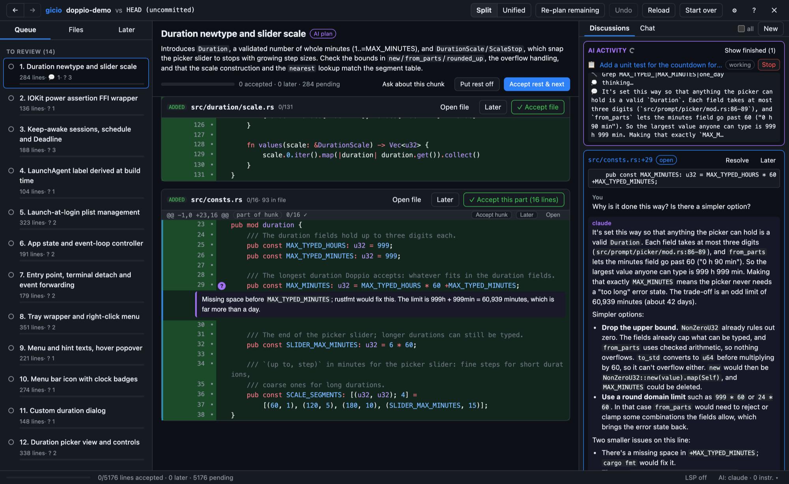
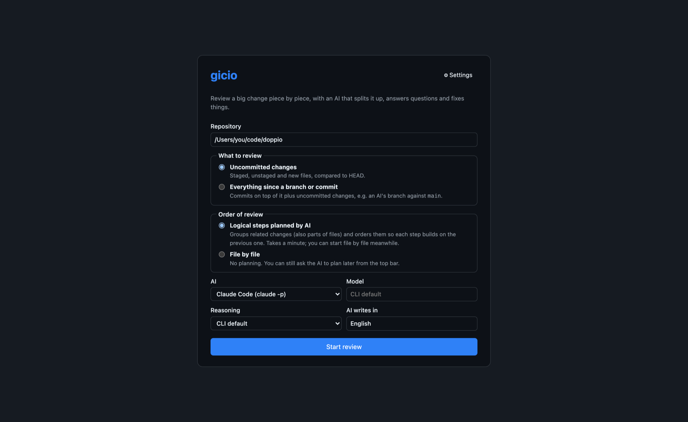
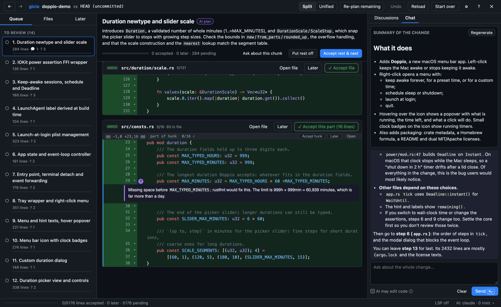
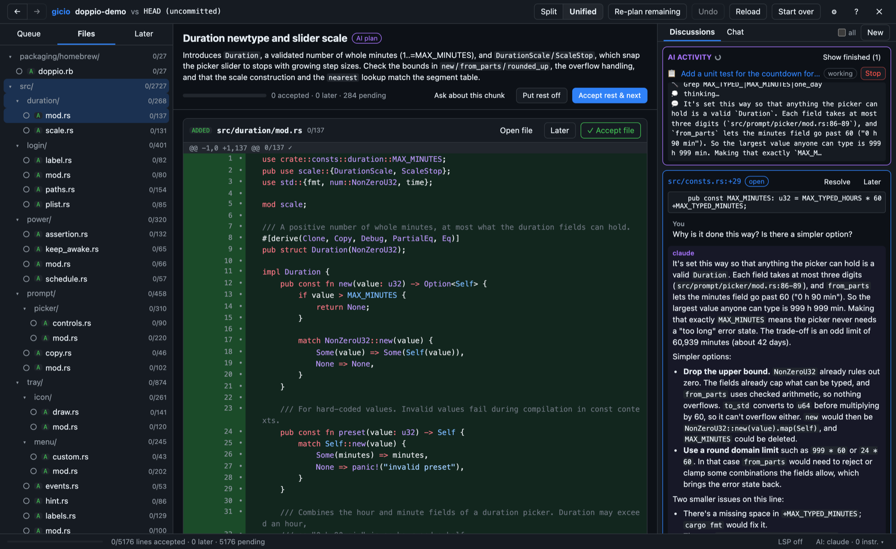
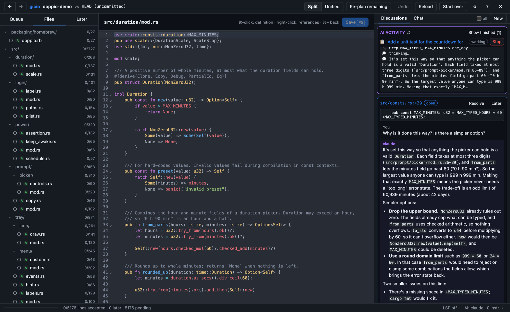
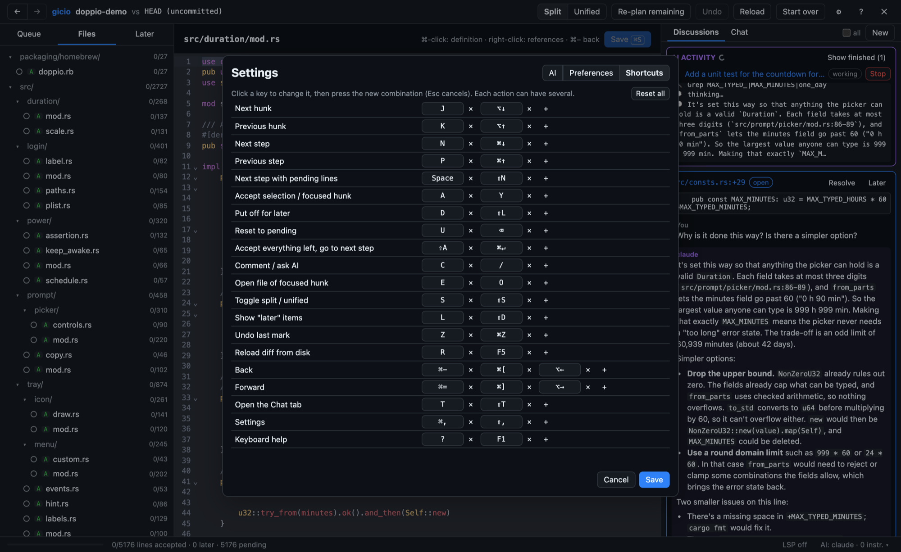

# WARNING!

At this stage, this project (except this and the next paragraps) is a full-ai-slop. Use it at your own risk. Treat it as a proof of concept — although a fully usable and incredibly useful one.

...which is kind of funny, considering that this project exists to deal with the huge amount of changes recently introduced mainly by AI. So, essentially, it's AI slop that prevents AI slop.

Hopefully, one day I'll use it to review its own code and polish it to the point where I feel comfortable removing this warning.

### Small disclaimer

I'm not a vibe coder, and I'm strongly against vibe coding anything beyond a proof of concept or an experiment.

That doesn't mean I'm against AI, though. Quite the opposite. I believe that responsible use of AI (which, hopefully, this project can make easier) opens up new possibilities and brings real value to us developers.

---

# Gicio


**gicio** is a desktop app for reviewing huge changes, such as a branch an AI agent wrote for you.
Instead of scrolling through a 3000-line diff, you get a queue of small, logically ordered review steps.
You accept code line by line, put things off for later, and ask questions right where you have them.
An AI (Claude Code, Codex, Copilot CLI or any command you like) answers. When you ask, it fixes the code,
and the queue adjusts to its edits.

**Works with** the AI coding CLIs you already have, with no API keys of its own:

- **Claude Code** (`claude`)
- **OpenAI Codex CLI** (`codex`)
- **GitHub Copilot CLI** (`copilot`)
- **anything else** you can run as a command that reads a prompt on stdin and prints the answer, such
  as a local model through `ollama run …`

So far I have tested it properly only with Claude Code.

## Why "gicio"?

Gicio (roughly "GHEE-cho") is a playful, affectionate way to say "all good" in Polish. It comes from git, which in everyday Polish today means "good" or "OK". A change that passes review is gicio - and the name gives a nod to Git, too.



## How it works

1. Point gicio at a repository and choose what to review: **uncommitted changes** (staged, unstaged
   and new files) or **everything since a branch or commit** (e.g. an AI's branch against `main`).
2. The AI reads the whole diff and plans **review steps**: one concern each, ordered so that
   understanding builds up (types → logic → wiring → tests). A big hunk or a new file can be split across
   steps. The AI adds short **notes (?)** where a reviewer would likely wonder "why?".
3. You go through the steps. Every changed line is **pending**, **accepted** or **put off for later**.
   Marks follow the code when the diff moves.
4. Select lines and **comment**. Each comment is either a note for yourself, a question the AI answers
   **now**, or an **AI to-do** that runs in the background while you keep reviewing.
5. When the AI edits code, gicio re-reads the working tree. Changed hunks stay in their step, and new
   code becomes a follow-up step (after the current one for answers, at the end of the queue for to-dos).

Nothing is committed, ever. The AI only edits your working tree, and only when you let it.

## Features

**Reviewing**
- Queue of AI-planned steps (or plain file by file), with a "Done" list and progress everywhere.
- Side-by-side or unified diff (added and deleted files are always unified), with syntax highlighting.
- Per-line marks: click the gutter dot to toggle a line, drag in the gutter to select a range, then
  accept, put off for later or reset, using the keyboard or the floating bar.
- "Later" tab: everything you put off, lines and discussions, to come back to at the end.
- File tree with per-file and per-folder progress. Files currently on screen are highlighted, and
  the file under your pointer is highlighted more subtly.
- Sticky file bar while scrolling, with one-click "Accept file" / "Accept this part".
- Back / forward navigation (⌘− / ⌘+), undo for marks, "Start over".

**Talking to the AI**
- Discussions anchored to lines, with three actions:
  - **Note**: just for you.
  - **Ask now**: the AI answers now.
  - **Add AI to-do**: queued background work; its changes land at the end of the queue.
- Live **AI activity** panel showing what the AI is doing (files read, edits, commands), with **Stop**.
- **Chat** tab for questions about the change as a whole, plus a one-click **summary**: what it does,
  how, risks, and where to look closely.
- Backends: Claude Code (`claude -p`), OpenAI Codex (`codex exec`), GitHub Copilot CLI (`copilot -p`)
  or a custom command that reads the prompt on stdin. Model and reasoning effort are configurable,
  also in the middle of a review.
- Project instructions and skills are respected: `CLAUDE.md`, `AGENTS.md`,
  `.github/copilot-instructions.md`, `.github/instructions/`, `.cursor/rules`, `GEMINI.md` and skills
  in `.claude/skills`, `.agents/skills`, `.codex/skills` and `.github/skills`. Whatever the chosen CLI
  does not read by itself is added to the prompt. Your own standing instructions from Settings come on top.
- Answers are instructed to be short and strictly on topic.

**Code navigation and editing**
- rust-analyzer integration: hover, ⌘-click go to definition, right-click find references. If the
  target is already on screen, the view scrolls there; otherwise the file opens in the main window.
- Open any changed file in a built-in editor (CodeMirror). Lines you write yourself count as
  accepted, and the diff and queue update on save.

**Settings**
- Default AI, model and reasoning; your own instructions for the AI; preferences (default layout,
  default order, auto-advance, notes expanded, hover delay…).
- Every keyboard shortcut can be changed, and every action has at least two of them.

## Screenshots

| | |
|---|---|
|  |  |
| Start: what to review, in which order, with which AI | Chat about the whole change, with a generated summary |
|  |  |
| File tree with progress, unified layout | Built-in editor with rust-analyzer |
|  | |
| Every shortcut is configurable | |

The screenshots show a review of doppio (`cargo install doppio-bar`), a small macOS menu bar app,
done with Claude Code. All AI texts in them are real output.

## Running

Requirements: Rust, Node.js, `git`, and at least one of `claude`, `codex` or `copilot` on your PATH.
For Rust projects, `rust-analyzer` enables code navigation.

```sh
npm install
npm run tauri dev
```

or build a release bundle with `npm run tauri build`.

If a CLI is not found (apps started from Finder get a minimal PATH), point gicio at it with
`GICIO_CLAUDE_BIN`, `GICIO_CODEX_BIN`, `GICIO_COPILOT_BIN` or `GICIO_RUST_ANALYZER_BIN`.

Review state lives in `.git/gicio/review-<base>.json` inside the reviewed repository, so you can close
the app and continue later. App settings live in the app's config directory.

## License

gicio is **free for non-commercial use** under the
[PolyForm Noncommercial License 1.0.0](LICENSE): personal use, hobby projects, research, education,
and use by charities and public institutions.

For commercial use, please contact me at [synek317@gmail.com](mailto:synek317@gmail.com). Honestly though, I don't
recommend it: this is an experimental proof of concept (see the warning at the top), not something to
build a business on.
